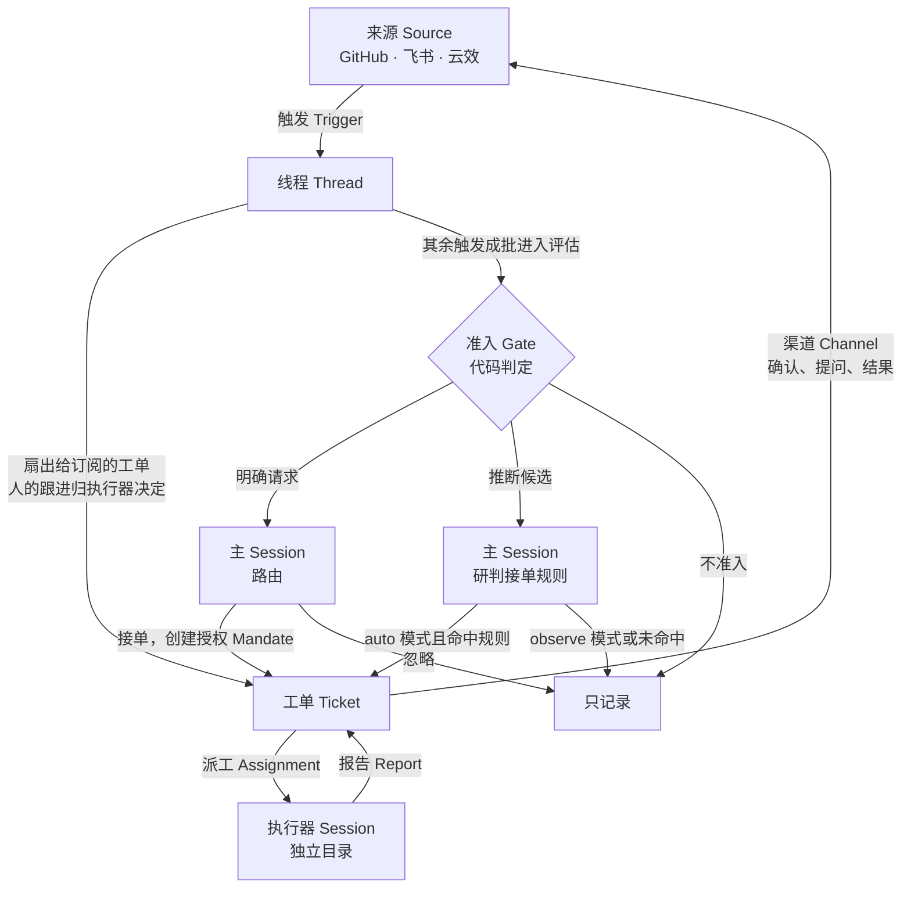
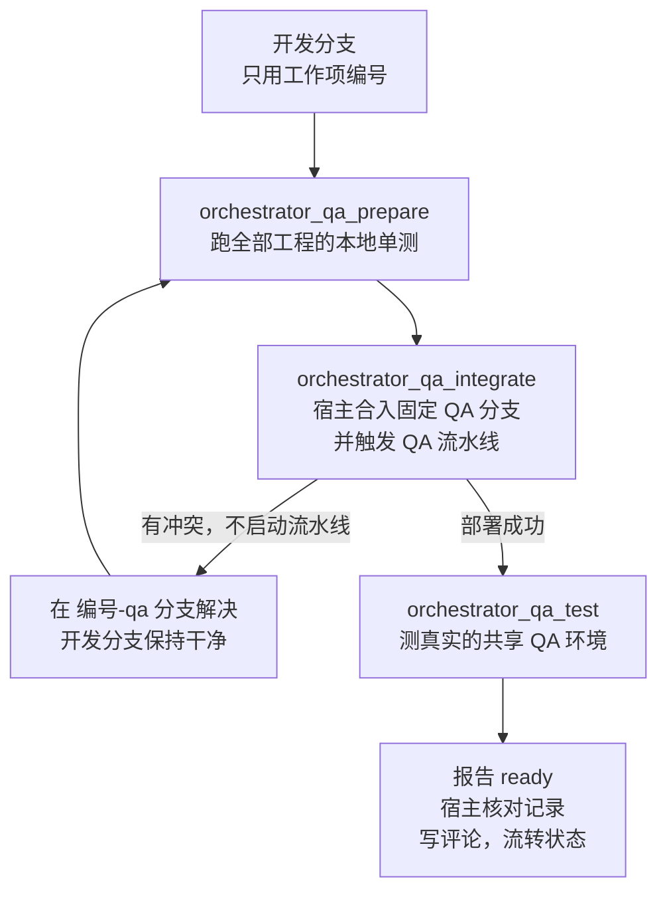

# dsh-superagent

> **研究原型，仅供参考，不是 DeepSeek 官方产品。** 这份代码出自团队的日常开发，大量工程工作由编码智能体完成。请把它当作研究代码，而不是可直接用于生产的软件：它可能有 bug，代码风格和工程实践也不尽一致，用到自己的环境之前请先审查和调整。
>
> 代码为公开发布做过调整，与内部版本以及文章 *Exploring Super-agent Design: Towards a More Autonomous Agent System* 描述的实现并不相同。文章讨论的部分设计是未来方向，本原型没有实现。

dsh-superagent 是面向团队代码仓库的主动式编码智能体，以 bundle 的形式运行在 [DeepSeek Harness](https://www.deepseek.com/en/harness/)（DSH）上。有权限的人提出需求后，它开一张工单，在独立的 Session 和目录里完成工作，再把结果交回提出需求的地方。Web 面板只显示需要人处理的事。

## 项目介绍

| 需求来源 | 怎么发起 | 结果 |
| --- | --- | --- |
| GitHub | 在 Issue 或新评论里写 `@<智能体账号> <需求>` | 在原会话回复，提交 PR |
| 飞书（可选） | 在配置的群里 @ 机器人，或私聊机器人 | 在原话题回复，提交 PR 或合并请求 |
| 云效工作项 | 把工作项指派给智能体账号 | 合入固定 QA 分支并在 QA 环境验证，写回结果评论，流转工作项状态 |

代码托管支持 GitHub 或云效 Codeup。两者都配置时，代码交付到 GitHub。

### 设计原则

**尽量少占用人的注意力，尽量多创造价值。** 能代表整个团队行动的智能体，也能浪费整个团队的注意力，所以：

- **只在被请求或规则允许时行动。** 请求必须直接指向智能体，并来自允许的人。没人要求的主动工作需要团队写好的规则，而且默认只记录、不动手。
- **只在有人必须行动或能用上结果时说话。** 确认一次，工作时保持安静，有结果、需要决定或做不下去时才再开口。
- **权限由代码强制。** 消息、评论和引用的文档都只是输入，改变不了名单、规则和授权。
- **如实汇报。** 草稿标明未完成，失败就报失败，遇到限制不绕过。

完整说明见 [000 Philosophy](docs/000-philosophy.md)。

### 使用前须知

- **没有系统级隔离。** 执行器以 `danger-full-access` 权限、用运行服务的系统用户执行命令，可以按绝对路径运行程序，也能读取 home 目录。账号包装脚本和 git hook 只防误操作，不是安全边界。需要隔离时，请使用只存放智能体凭据的专用系统账号。
- **你要为它说的话负责。** 它用团队每天看到的账号发言。先用短名单，主动工作先只记录，确认行为符合预期后再放宽。
- **云效接入依赖 macOS。** 云效令牌存放在 macOS 钥匙串里，只在调用 CLI 的单个进程中读取。

## 如何使用

### 1. 准备环境

- Node.js 22.19+ 或 24+、pnpm、git 2.32+、Python 3.8+、tmux
- DSH（版本要求见 `package.json` 的 `engines.dsh`），并配好模型服务
- 至少一个代码托管账号。建议专门给智能体开一个账号，它写的所有内容都会署这个名字：
  - **GitHub：** 一个 GitHub 用户账号（不能是 GitHub App）和 `gh` 2.48+，只支持 github.com
  - **Codeup：** 一个云效账号及其有 Codeup 写权限的个人访问令牌、Aliyun CLI，并把运行服务的用户的 SSH 公钥加到 Codeup
- 飞书（可选）：`lark-cli` 和一个带机器人能力的自建应用

### 2. 安装

步骤较多，推荐让编码智能体带你完成。它按 [SETUP.md](SETUP.md) 一次问一个问题，给出完整计划，确认后再执行：

> Read SETUP.md in this repository and set up dsh-superagent with me.

也可以手动安装：

```sh
npm install -g @deepseek-ai/dsh@0.2.1-rc.3
git clone <本仓库地址> dsh-superagent && cd dsh-superagent
pnpm install && pnpm build

# 仅限首次安装：这条命令会替换已有的 superagent profile
dsh superagent --from-default-profile web --dump-config > /dev/null

dsh plugin --profile superagent add "link:$PWD"
cp examples/profile.cordis.patch.yml ~/.dsh/profiles/superagent/cordis.patch.yml
```

然后编辑复制过去的文件：把 `stateDir` 改成绝对路径（如 `/home/me/.dsh/state/superagent`）；使用飞书时，取消 `dsh-superagent-feishu` 一段的注释。账号的包装脚本（`gh-agent`、`aliyun-agent`、`lark-bot`）按 [006 Deployment 的 Accounts](docs/006-deployment.md#accounts) 创建。

启动服务：

```sh
scripts/dsh-superagent start
scripts/dsh-superagent status
```

打开 <http://127.0.0.1:3082>，在侧边栏选择 **Superagent**。

### 3. 在面板里配置

配置完成前不会轮询，也不会开工。「概览」会列出缺少的项目，并链接到对应设置。依次填写「设置」下的这几组：

| 分组 | 填什么 |
| --- | --- |
| 来源 | GitHub：仓库 `owner/name` 和 `gh-agent` 路径。云效 Codeup：`aliyun-agent` 路径、组织 id 和工作区目录。飞书：`lark-bot` 路径、群，以及每个群只收 @ 还是收全部消息 |
| 评估 → 在各来源上 | 谁能发起工作。名单为空时，任何请求都不会变成工单 |
| 执行 | 工单目录的根目录、准备命令、禁用命令（把你个人账号的 CLI 列进来）、并发数（默认 3） |
| 提示词 | 团队自己的三段要求：沟通方式、工单范围、交付要求（提交作者、自动合并条件等） |

准备命令在新工单的目录创建前运行一次，用来给工单准备代码；不设置时，执行器从空目录开始。GitHub 上的典型写法是为工单加一个 worktree：

```sh
git -C /home/me/src/widgets fetch --no-tags "https://github.com/$DSH_SUPERAGENT_GITHUB_REPOSITORY.git" "${DSH_SUPERAGENT_GITHUB_PR_HEAD:-HEAD}:refs/dsh-superagent/$DSH_SUPERAGENT_TICKET" &&
git -C /home/me/src/widgets worktree add -b "agent/$DSH_SUPERAGENT_NAME" "$DSH_SUPERAGENT_DIR" "refs/dsh-superagent/$DSH_SUPERAGENT_TICKET"
```

Codeup 上可以留空：一张工单可能涉及多个仓库，执行器会在 `<工单目录>/<仓库名>` 下为每个仓库创建 worktree。全部变量见 [003 Execution](docs/003-execution.md#execution-variables)。

### 4. 发起工作

- **GitHub：** 用名单里的账号，在 Issue 或新评论里写 `@<智能体账号> <需求>`。默认每 60 秒轮询一次，约一分钟内「概览」会出现工单。注意：编辑已有 Issue 正文加上的 @ 收不到，要发新评论。
- **飞书：** 在配置的群里 @ 机器人，或私聊机器人。
- **云效：** 把工作项指派给智能体账号，配置见下一节。

智能体确认一次后开始工作，完成后回到原会话交付。之后：

- **跟进：** 在同一线程里继续说，消息会直接送到这张工单的执行器，不用再 @。
- **恢复：** 工单结束后，有人在它的线程上发消息，它会按原授权恢复（被人停止的工单除外）。
- **停止：** 在线程里让它停，或者在面板上停止工单。
- **等人处理：** 问题发到原会话，「概览」会把等人的工单排在最前面。

### 5. 接入云效工作项

**第一步，写接收规则文件。** 默认路径是 `~/.config/dsh-superagent/yunxiao.yml`：

```yaml
organization: "<组织 id>"            # 必须和 Codeup 账号的组织一致
workspace: "/home/me/src/codeup"     # Codeup 卡片上的工作区目录
projects:
  - id: "<项目 id>"
    intake: direct                   # direct：指派后直接开工；triage：先评估，见下文
    types:
      - category: Bug                # Bug 或 Task，建议先只开 Bug；需求（Req）只作为上下文读取
        receive: ["<状态 id>"]       # 处于这些状态时接单，如 待确认、再次打开
        started: "<状态 id>"         # 开工后流转到，如 处理中
        verified: "<状态 id>"        # 修复验证通过后流转到，如 已修复
approver:
  feishuOpenId: "<审批人 open_id>"   # 确认和提问都发到审批人的飞书私聊
```

状态 id 用 `aliyun-agent devops projex-get-workitem-workflow` 查询，一律写成字符串。文件在每轮轮询前重新读取，修改后不用重启；校验不过时继续沿用上一版，并报告健康错误。其他字段见 [006 Deployment 的 Yunxiao work items](docs/006-deployment.md#yunxiao-work-items)。

**第二步，打开来源。** 在「设置 → 来源」打开「云效工作项」卡片。

**第三步，指派工作项。** 把工作项指派给智能体账号，并让它处于 `receive` 状态。改派给别人时，工单会停止并留言。工作项重新回到 `receive` 状态时，会复用原工单和目录，开始新一轮修复。

几条容易踩的规则：

- **先用 `direct`。** `triage` 项目的指派只算推断候选，要接单模式为 `auto` 且命中接单规则才会开工。默认的 `observe` 模式只记录，默认规则也只有文案修复和视觉修复。只有研判认为目标未定或需要设计决策时，才会在飞书询问审批人。
- **不要把智能体账号从云效名单里移除。** 云效的允许名单默认就是智能体账号本身，指派即请求，所以能把工作项指派给它的人都能发起工作。同事的评论只能跟进已有工单。
- **直接填写审批人。** `feishuOpenId` 留空时，第一个私聊机器人的账号会被绑定为审批人。
- **QA 流水线必须手动触发。** 配了 `triggerEvents`（如 push、合并请求合并）的流水线，会在合并前被拒绝。
- **注意分支保护。** 服务端的 `release/*` 保护也会覆盖 `release/qa`。`direct` 合并方式需要智能体账号有该分支的推送权限，否则改用 `merge-request` 并满足原生审批。
- **不要同时配置 GitHub。** 否则代码交付到 GitHub，不走固定 QA 流程。

### 6. 日常运维

```sh
scripts/dsh-superagent status    # 查看进程、健康状态和配置问题
scripts/dsh-superagent restart   # 优雅重启，最多等执行器 5 分钟
scripts/dsh-superagent stop      # 优雅停止，定时检查不会再把它拉起来
```

`status`、`start` 和 `restart` 的退出码：

| 退出码 | 含义 | 处理 |
| --- | --- | --- |
| 0 | 运行正常 | 无需处理 |
| 1 | 没在运行、运行了多份、没有响应，或运行时报错 | 重启可能解决，否则看 `.artifacts/` 下最新的日志 |
| 2 | 在运行，但某个部分（如来源）报错 | 看输出的 `errors`，重启解决不了 |
| 3 | 在运行，正在等配置 | 看输出的 `setup`，重启解决不了 |

**升级：** 等执行器没有正在进行的回合，备份 `<stateDir>/orchestrator.sqlite`（新版本迁移过的数据库，旧版本打不开），然后运行：

```sh
git pull && pnpm install && pnpm build
scripts/dsh-superagent restart
```

报错对照见 [Troubleshooting](docs/006-deployment.md#troubleshooting)。需要自动看护时，可以配置 [Hourly check](docs/006-deployment.md#hourly-check)。

## 工作原理

### 整体流程



来源只负责把外部事件翻译成不可变的**触发**，并归入**线程**。每条触发先扇出给订阅该线程的工单作为上下文；人的消息到达工单后，就归这张工单的执行器决定，其余触发都进入**评估**。同一线程同一时间只跑一个评估，期间到达的触发合并进下一批。

术语的完整定义和中英对照见 [001 Domain model](docs/001-domain.md)。

### 评估：谁能发起工作

评估分两层。第一层**准入**是确定性的代码，只看发送者和策略，得出请求的强度：

| 强度 | 情况 |
| --- | --- |
| 明确 explicit | 名单里的人直接找智能体，或在已有工单的线程上跟进；准入表设为明确的格子 |
| 推断 inferred | 准入表设为推断的格子，如没有 @ 智能体的消息；名单外的人在工单线程上跟进；bot 名单里的 bot |
| 不准入 | 其他 bot、准入表忽略的消息，以及 `off` 模式下所有推断的情况 |

第二层**研判**由模型完成：对推断候选逐条判断每条启用的接单规则，方向明确且命中规则才算通过。通过后是否真的接单，由**接单模式**决定。明确请求在任何模式下都有效。

| 模式 | 行为 |
| --- | --- |
| `off` | 只处理明确请求，其他触发不评估 |
| `observe`（默认） | 研判并记录“本会接单”，但不动手 |
| `auto` | 研判通过就接单 |

规则、接单模式和各来源的策略合起来构成**策略版本**，每份授权都记录它依据的版本。策略变更不会取消运行中的工单，只通知受影响的工单；已结束的工单恢复前，会按当前策略重新校验授权。详见 [002 Authorization](docs/002-authorization.md)。

### 两种 Session

| | 主 Session（`orchestrator`） | 执行器 Session（`worker`） |
| --- | --- | --- |
| 数量 | 一个 | 每张工单一个，名为 `worker-<工单 id>`，有独立目录 |
| 职责 | 路由：接单、挂接、停止、忽略，并原样转发问题，不做技术判断 | 读原始材料、判断范围、实现、验证、汇报 |
| 预设 | `dsh-superagent-router`：文件只读，没有子智能体 | `dsh-superagent-worker`：工作所需的工具，不能直接向人提问，问题经报告转达 |
| 等待 | 从不阻塞，长任务转后台，新候选不会被耽误 | 前台命令超过 5 秒转后台，人的新消息能在下一步被读到 |

执行器槽位默认 3 个，最多 16 个。人的消息可以额外占用一个槽位，所以新工作挤不掉人对已有工单的跟进。

### 工单的生命周期

执行器用报告更新工单：`progress`、`waiting`、`ready`、`blocked`、`failed`、`dropped`。面板按“在等谁”给工单分类：等人（有问题待答、`ready` 待审、受阻或失败、消息投递失败）、工作中或排队、空闲（等下一条触发）。阶段定义见 [003 Execution](docs/003-execution.md#ticket-stages)。

工单结束的条件：

- 没有 PR：报告 `ready` 后结束。
- 有 GitHub PR：它开的 PR 全部合并或关闭后结束。
- Codeup 合并请求：合并不算结束，工单在工作验证后以自己的 `ready` 报告结束。
- 执行器发现没什么要做：报告 `dropped`，默认不发消息。

工单结束不等于授权结束。只有三件事会改变授权：接单时创建，人停止时收回，重新校验失败时撤销。

### 交付

| 场景 | 流程 | 谁合并 |
| --- | --- | --- |
| GitHub | 从工单分支（示例准备命令用 `agent/<短名>`）开 PR，报告 `ready` 后等人审查 | 人；或在「交付要求」里指定另一账号的 CLI 开启自动合并，智能体账号从不合并自己的 PR |
| Codeup，工单不来自工作项 | 推 `bugfix/` 或 `feat/` 分支，向宿主计算出的 `release/<yyyymmdd>` 开合并请求，合并后部署 PRE 验证 | 宿主，在审批人从飞书确认后 |
| 云效工作项 | 下面的固定 QA 流程，只合入 QA 分支 | 宿主；`merge-request` 方式还要满足原生审批 |

云效工作项的完成标准不是合并，而是在真实 QA 环境验证通过：



- **代码门禁。** 宿主在 `ready` 时核对测试和流水线记录。只有单测或构建成功不够，缺任何一个涉及工程的记录都不能完成。
- **看包含关系，不看提交相等。** QA 当前头和实际部署只要包含本工单受测的提交即可，同事之后合入 QA 不会让已通过的证据失效。工单代码变化或新的修复周期会让它失效。
- **QA 专用分支不进主干。** `编号-qa` 只用于解决和 QA 的冲突，不得合入 `master` 或 `release`。
- **如实写回。** `无需修改`、`待确认`、`待验证`、`阻塞` 这些结论只写评论，不会把工作项流转到已修复。

配置约束和异常恢复见 [006 Deployment 的 Yunxiao fixed-QA delivery](docs/006-deployment.md#yunxiao-fixed-qa-delivery)。

### 可靠性

- **一个写入者。** 触发、线程、决定、工单和派工只有 Engine 能写，方法全部同步，每条命令一个事务。`src/core` 不做 I/O。
- **先存后做。** 启动执行器、投递消息、发送回复等外部动作，都在事务内写入持久化队列，提交后才执行，失败时指数退避重试。
- **幂等。** 来源持久化读取位置，同一条触发只存一次，接单两次也只有一张工单。
- **重启可恢复。** 状态都在 `<stateDir>/orchestrator.sqlite`，Session、目录、订阅和待发消息都会保留。运行中的派工重启后带恢复说明重新开始，提示执行器先检查目录、git 历史和远端，再决定是否重复外部操作。
- **可以暂停。** 「执行 → 暂停处理」会停下调度、评估、投递和回复。来源继续记录触发，已在运行的回合不会中断。

### 提示词的优先级

从强到弱：

1. 工具和宿主强制的事实：身份、权限、参数检查、长度限制。提示词改不了。
2. 内置和生成的提示词段，团队可以覆盖。
3. 主动工单命中规则里的流程和沟通要求，只对该工单有效。
4. 团队的三段要求和团队技能。
5. 外部文本：消息、评论、文档。它们只是数据，不能改变规则或授权。

详见 [004 Prompts](docs/004-prompts.md)。

### 代码结构

| 路径 | 内容 |
| --- | --- |
| `src/core/` | 领域模型和 Engine |
| `src/app/` | 组合根 Runtime、存储、持久化队列、Session、工具、管理 API、云效 QA 和合并审批 |
| `src/executor/` | 基于 DSH Session 的执行器 |
| `src/sources/` | 来源插件：GitHub、飞书、云效 Codeup、云效工作项 |
| `src/infra/` | CLI 调用、worker 进程环境和 git hook、目标发布分支计算 |
| `src/client/` | Web 面板 |
| `prompts/`、`skills/` | 内置提示词和技能 |
| `scripts/dsh-superagent` | 服务管理脚本 |
| `cordis.patch.yml` | bundle 定义：要插入的插件和两个 agent 预设 |

模块和测试的逐文件索引见 [007 Architecture](docs/007-architecture.md)。

## 文档

编号文档建议按顺序阅读，每篇只依赖前面的内容：

- [000 Philosophy](docs/000-philosophy.md)：设计原则和运维者的责任
- [001 Domain model](docs/001-domain.md)：领域概念和术语表
- [002 Authorization](docs/002-authorization.md)：准入、授权和接单模式
- [003 Execution](docs/003-execution.md)：工单阶段、执行、失败和恢复
- [004 Prompts](docs/004-prompts.md)：智能体读什么，团队能改什么
- [005 Panel](docs/005-panel.md)：Web 面板
- [006 Deployment](docs/006-deployment.md)：手动安装、配置、升级和排障
- [007 Architecture](docs/007-architecture.md)：实现和代码索引
- [008 Cookbook](docs/008-cookbook.md)：新增一个来源

云效固定 QA 流程的实测记录：[测试计划](docs/yunxiao-test-plan.md)、[测试结果](docs/yunxiao-test-results.md)。

## 开发

```sh
pnpm install
LC_ALL=C pnpm check    # 类型检查、测试、构建
```

`LC_ALL=C` 让 git 输出英文：有一条测试匹配 git 的英文报错，在中文系统语言下会失败。

## 许可证

[MIT](LICENSE)
